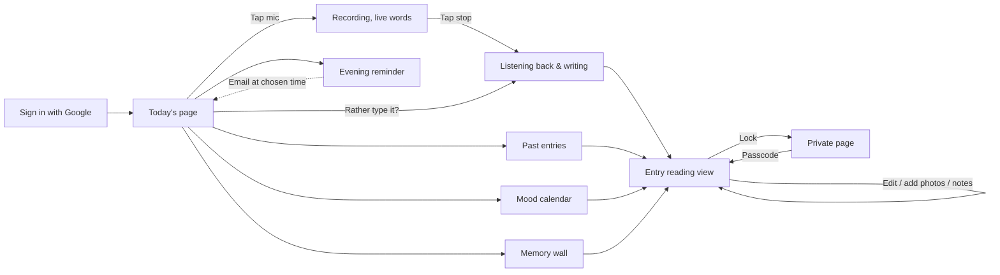
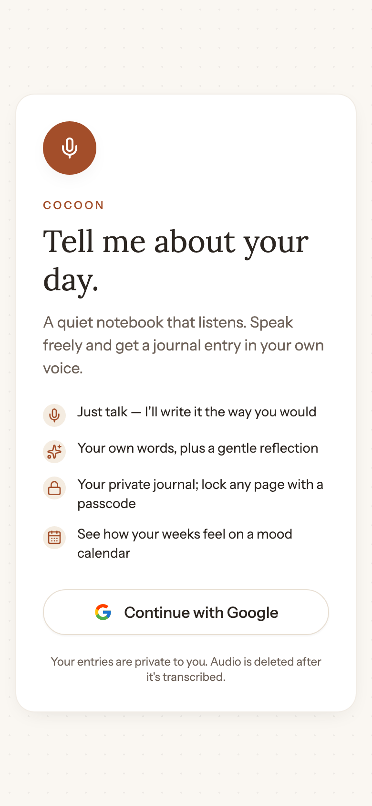
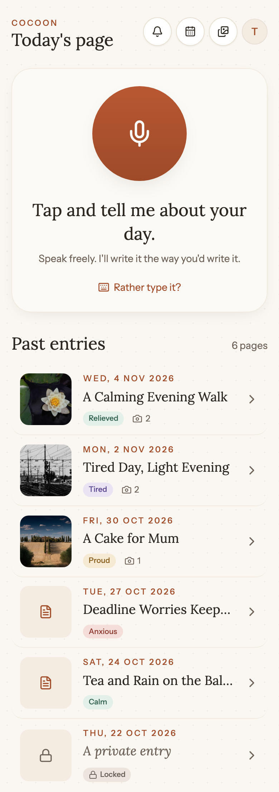
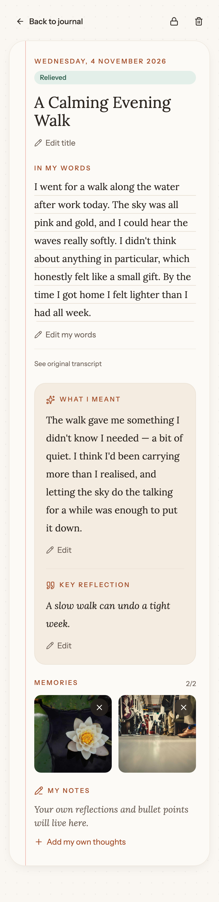
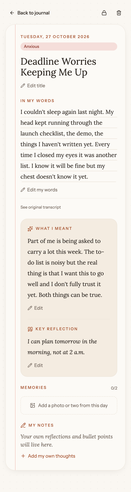

# Cocoon — User Journey

A walkthrough of Cocoon with screenshots of the real app. Claude Code updates this after every
step that adds or changes a screen (see CLAUDE.md → "User journey document").
Screenshots: `docs/journey/` · Spec: `docs/SPEC.md` · Original mockups: `docs/mockups/`

**Last updated:** step 9 (Memories — photos) · **Build step:** 9 of 21

## The journey at a glance



---

## 1. Sign in

[Laptop view](journey/01-sign-in-default-laptop.png)

**What you see:** a centred card on the dotted paper background with a clay
mic, the COCOON eyebrow, the serif heading *"Tell me about your day."*, a
warm subline, four bullets (talk, your own words + a reflection, lock any
page, mood calendar), a **Continue with Google** button, and a short
footer about privacy.

**What you can do:** tap *Continue with Google*. The button shows a spinner
for about half a second (mocked), then you land on Today's page. If you
tried to reach a protected URL first (e.g. `/calendar`), you bounce there
after signing in instead of landing on home.

**States:** default · loading (button disabled, spinner next to
*"Signing in…"*). Error toast is wired but can't trigger with the mock.

**Next:** → Today's page.

**Built in:** step 5 · **Notes:** real Google OAuth arrives in step 15.
The mock session lives in `localStorage` under `cocoon.session.v1` — clear
that key in DevTools to simulate a signed-out visitor.

## 2. Today's page

[Laptop view](journey/02-home-idle-laptop.png)

**What you see:** the Cocoon header (clay COCOON eyebrow, serif "Today's
page" + today's date on laptop, three quick-action buttons, avatar), the
big clay mic button with *"Tap and tell me about your day."* and the
*"Rather type it?"* link underneath, then the **Past entries** list of
your journal cards.

**What you can do:** tap the mic to record (next section), tap *Rather
type it?* to write instead, tap any past entry to open it, tap *Show
earlier pages* at the bottom to load older entries.

**States:** idle (shown above) · recording (mockup `03-recording`,
not auto-screenshotted — needs real mic input) · writing (mockup
`04-writing-entry`, same) · permission-denied · failed-write (editable
Try again card).

**Next:** → Recording (3) or → Reading an entry (6).

**Built in:** step 7 · **Notes:** mockup 02's two language pickers are
out (English-only MVP; single picker in the account menu in step 12).
The locked past-entry card hides the title, mood, and photos.

## 3. Recording
_Coming in step 7._ (SPEC §2.2 · mockup `03-recording`)

## 4. Writing your entry
_Coming in step 7._ (SPEC §2.2 · mockup `04-writing-entry`)

## 5. Past entries
Captured in-line on section 2 above (the list lives on Home, mockup `05`).

**Card layout:** a 72–80 px rounded thumbnail of the first photo (or a
parchment square with a note icon if the entry has no photos), a short
date eyebrow (*"Wed, 4 Nov 2026"*), the serif title truncated to one
line, a mood badge pill, and a camera icon with the photo count when
present. Chevron at the right.

**Locked variant:** no thumbnail (parchment square + lock icon),
*"A private entry"* in italic serif, grey "Locked" badge.

**Count on the right:** "6 pages" — `total_count` from the API.

**Pagination:** 20 at a time. When there are more pages, a *Show
earlier pages* button appears at the bottom and loads the next page
without leaving Home.

**Empty state:** *"Your first page starts here. Tap the mic above when
you're ready."*

**Built in:** step 7.

## 6. Reading and editing an entry

[Laptop view](journey/06-entry-reading-default-laptop.png)

**What you see:** a top bar with *Back to journal* (left) and *Lock* /
*Delete* (right), then the paper sheet with a faint red margin line
down the left. The sheet carries the date eyebrow + mood badge, a
large serif **title**, the **In my words** body on ruled lines (with
a *See original transcript* toggle underneath), a parchment **What I
meant** card holding the AI interpretation + **Key reflection**, a
**Memories** section with up to 2 photo thumbnails, and **My notes**
at the bottom.

**What you can do:** read it. Tap *Edit* under any section — the
section swaps for a textarea (or input for the title) with × *Cancel*
and ✓ *Save* buttons. A **"Saved."** toast confirms. Tap *See
original transcript* to peek at the raw speech-to-text. Tap *Back to
journal* to return home.

**States:** default (shown above) · editing (textarea with Save /
Cancel) · support-note (shown when the AI flagged the entry as heavy;
toggle with `?support=1` for visual testing) · locked (fixture #6 —
"This page is private" placeholder, full unlock dialog comes in
step 10) · not-found (bad id) · generic error.

**Next:** → Memory wall (step 11) or back to Home (section 2).

**Built in:** step 8 · **Notes:** Lock / Delete buttons show a *Coming
in step 10* toast for now; the Memories section is now fully live —
see section 7.

## 7. Photos (Memories)

[Filled on laptop](journey/06-entry-reading-default-laptop.png)

[Empty state on laptop](journey/06b-entry-reading-empty-memories-laptop.png)

**What you see:** a **MEMORIES** eyebrow with a `0/2` / `1/2` / `2/2`
counter on the right, then either a square-thumbnail grid of this
day's photos or a dashed *"Add a photo or two from this day"* button.
At 2/2 the dashed button disappears — the entry is full.

**What you can do:** tap the dashed button → your phone's photo
picker opens. Pick any image (even a huge iPhone HEIC — it's
converted to JPEG and resized to at most 1600 px in your browser
before it uploads). A thumbnail appears and you get a *"Photo
added."* toast. Tap a thumbnail → a full-size viewer fills the
screen; tap the backdrop, press Esc, or tap × to close. Tap the ×
chip on a thumbnail → a warm *"Remove this photo?"* confirm asks
before deleting.

**States:** empty (`0/2`, dashed button shown) · one photo (`1/2`,
one thumbnail + dashed button) · full (`2/2`, two thumbnails, no
dashed button) · uploading (dashed button shows a spinner and
*"Adding photo…"*) · viewer open (dark backdrop, image centred) ·
remove-confirm open (Keep / Remove).

**Next:** → Lock the entry (step 10) or back to Home.

**Built in:** step 9 · **Notes:** the resize happens entirely in
your browser so bytes never leave your phone un-shrunk. Photo URLs
in mock mode are `blob:` references tied to the current tab — they
won't survive a page refresh. Real Supabase Storage URLs arrive in
step 17.

## 8. Locking a page
_Coming in step 10._ (SPEC §2.5 · mockups `10`, `11`)

## 9. Mood calendar
_Coming in step 11._ (SPEC §2.6 · mockup `12-mood-calendar`)

## 10. Memory wall
_Coming in step 11._ (SPEC §2.7 · mockup `13-memory-wall`)

## 11. Evening reminder
_Coming in step 12._ (SPEC §2.8 · mockup `14-reminder`)

## 12. Account menu (language, export, delete, sign out)
_Coming in step 12._

## 13. Laptop and iPad
_Coming in step 13._ (SPEC §2.9 · mockups `15`, `16`)

---

### Section template (Claude Code: use this for each screen)

```
## N. <Screen name>

[Laptop view](journey/NN-<screen>-default-laptop.png)

**What you see:** …
**What you can do:** …
**States:** default · loading · empty · error · locked (link each screenshot)
**Next:** → <next screen>
**Built in:** step N · **Notes:** differences from mockup, open questions
```
