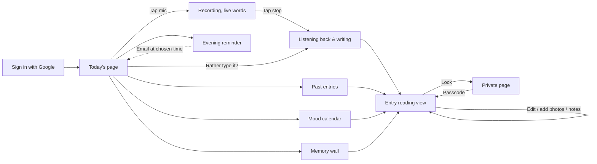

# Cocoon — User Journey

A walkthrough of Cocoon with screenshots of the real app. Claude Code updates this after every
step that adds or changes a screen (see CLAUDE.md → "User journey document").
Screenshots: `docs/journey/` · Spec: `docs/SPEC.md` · Original mockups: `docs/mockups/`

**Last updated:** _not started_ · **Build step:** 0 of 21

## The journey at a glance



---

## 1. Sign in
_Coming in step 5._ (SPEC §2.1 · mockup `01-sign-in`)

## 2. Today's page
_Coming in step 7._ (SPEC §2.2 · mockup `02-home`)

## 3. Recording
_Coming in step 7._ (SPEC §2.2 · mockup `03-recording`)

## 4. Writing your entry
_Coming in step 7._ (SPEC §2.2 · mockup `04-writing-entry`)

## 5. Past entries
_Coming in step 7._ (SPEC §2.3 · mockup `05-past-entries`)

## 6. Reading and editing an entry
_Coming in step 8._ (SPEC §2.4 · mockups `06`–`09`)

## 7. Photos (Memories)
_Coming in step 9._ (SPEC §2.4)

## 8. Locking a page
_Coming in step 10._ (SPEC §2.5 · mockups `10`, `11`)

## 9. Mood calendar
_Coming in step 11._ (SPEC §2.6 · mockup `12-mood-calendar`)

## 10. Memory wall
_Coming in step 11._ (SPEC §2.7 · mockup `13-memory-wall`)

## 11. Evening reminder
_Coming in step 12._ (SPEC §2.8 · mockup `14-reminder`)

## 12. Account menu (language, export, delete, sign out)
_Coming in step 12._

## 13. Laptop and iPad
_Coming in step 13._ (SPEC §2.9 · mockups `15`, `16`)

---

### Section template (Claude Code: use this for each screen)

```
## N. <Screen name>

[Laptop view](journey/NN-<screen>-default-laptop.png)

**What you see:** …
**What you can do:** …
**States:** default · loading · empty · error · locked (link each screenshot)
**Next:** → <next screen>
**Built in:** step N · **Notes:** differences from mockup, open questions
```
