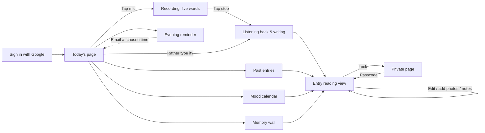
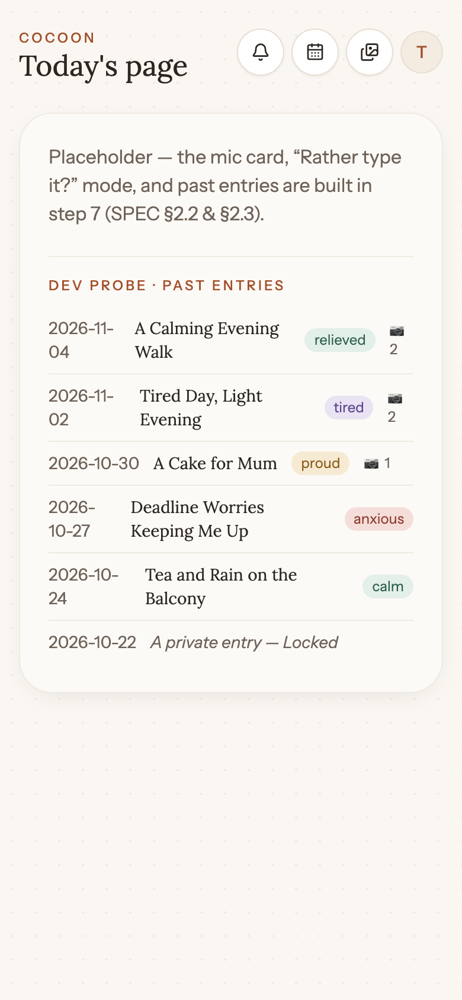

# Cocoon — User Journey

A walkthrough of Cocoon with screenshots of the real app. Claude Code updates this after every
step that adds or changes a screen (see CLAUDE.md → "User journey document").
Screenshots: `docs/journey/` · Spec: `docs/SPEC.md` · Original mockups: `docs/mockups/`

**Last updated:** step 5 (sign-in + route guards) · **Build step:** 5 of 21

## The journey at a glance



---

## 1. Sign in

[Laptop view](journey/01-sign-in-default-laptop.png)

**What you see:** a centred card on the dotted paper background with a clay
mic, the COCOON eyebrow, the serif heading *"Tell me about your day."*, a
warm subline, four bullets (talk, your own words + a reflection, lock any
page, mood calendar), a **Continue with Google** button, and a short
footer about privacy.

**What you can do:** tap *Continue with Google*. The button shows a spinner
for about half a second (mocked), then you land on Today's page. If you
tried to reach a protected URL first (e.g. `/calendar`), you bounce there
after signing in instead of landing on home.

**States:** default · loading (button disabled, spinner next to
*"Signing in…"*). Error toast is wired but can't trigger with the mock.

**Next:** → Today's page.

**Built in:** step 5 · **Notes:** real Google OAuth arrives in step 15.
The mock session lives in `localStorage` under `cocoon.session.v1` — clear
that key in DevTools to simulate a signed-out visitor.

## 2. Today's page

[Laptop view](journey/02-home-default-laptop.png)

**What you see:** the Cocoon header — small clay "COCOON" label, large serif
"Today's page" title (with today's date next to it on laptop), three round
quick-action buttons (Reminder / Mood calendar / Memories), and the avatar
menu — sitting on the off-white dotted paper background. Below it is an empty
paper-sheet card where the mic and past entries will live.

**What you can do:** open the Mood calendar and Memory wall from the header;
open the account menu (items show a "Coming in step 12" toast for now).

**States:** default (shown above). Recording / writing / past-entry states
come in step 7.

**Next:** → Recording (step 7).

**Built in:** step 3 (shell) · **Notes:** mic card, "Rather type it?", and
past entries are the heart of this screen and land in step 7.

## 3. Recording
_Coming in step 7._ (SPEC §2.2 · mockup `03-recording`)

## 4. Writing your entry
_Coming in step 7._ (SPEC §2.2 · mockup `04-writing-entry`)

## 5. Past entries
_Coming in step 7._ (SPEC §2.3 · mockup `05-past-entries`)

## 6. Reading and editing an entry
_Coming in step 8._ (SPEC §2.4 · mockups `06`–`09`)

## 7. Photos (Memories)
_Coming in step 9._ (SPEC §2.4)

## 8. Locking a page
_Coming in step 10._ (SPEC §2.5 · mockups `10`, `11`)

## 9. Mood calendar
_Coming in step 11._ (SPEC §2.6 · mockup `12-mood-calendar`)

## 10. Memory wall
_Coming in step 11._ (SPEC §2.7 · mockup `13-memory-wall`)

## 11. Evening reminder
_Coming in step 12._ (SPEC §2.8 · mockup `14-reminder`)

## 12. Account menu (language, export, delete, sign out)
_Coming in step 12._

## 13. Laptop and iPad
_Coming in step 13._ (SPEC §2.9 · mockups `15`, `16`)

---

### Section template (Claude Code: use this for each screen)

```
## N. <Screen name>

[Laptop view](journey/NN-<screen>-default-laptop.png)

**What you see:** …
**What you can do:** …
**States:** default · loading · empty · error · locked (link each screenshot)
**Next:** → <next screen>
**Built in:** step N · **Notes:** differences from mockup, open questions
```
